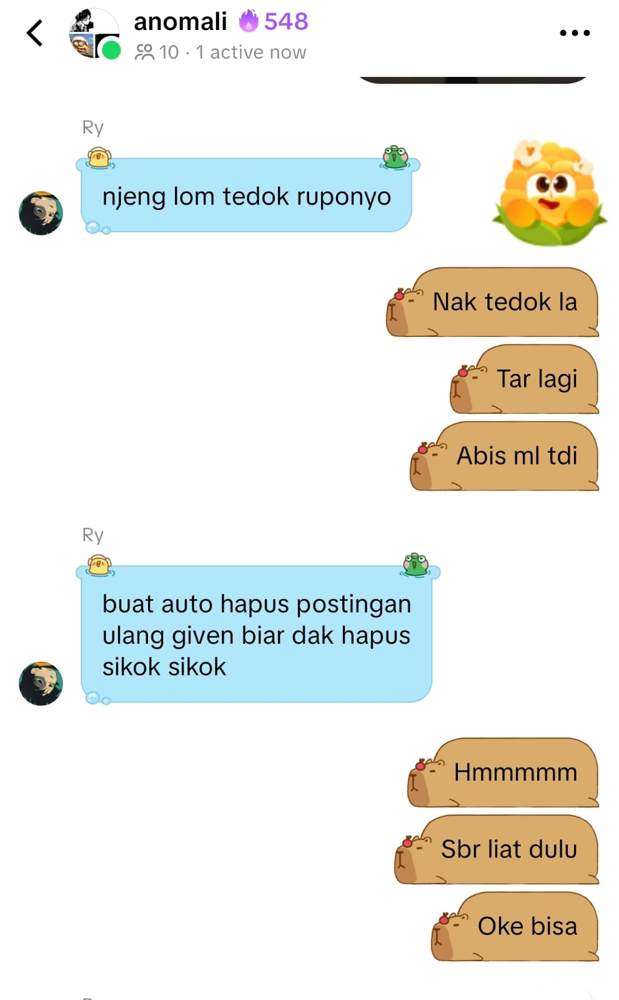

# TikTok Repost Remover (Selenium)

A Python + Selenium script that deletes TikTok reposts automatically. You can delete all reposts, or only the ones that match a caption keyword.

## Backstory

At 00:56 AM, a friend messaged me. He asked me to build a tool that deletes TikTok reposts automatically. At first, I did not take it seriously. I thought: "This is a small thing. Reposts are public anyway. Why repost something if you will delete it later?" I only wanted to help a little bit.

But after I looked closer, I saw this was a real problem for many people. Some accounts have a lot of reposts, sometimes from many years of using TikTok. And TikTok **does not have a button to delete all reposts at once**. The only official way is to open each repost one by one, then press the remove button, again and again. If you have thousands of reposts, this is not realistic to do by hand.

To show you the size of the problem: my friend who asked for this tool had **1,600+ reposts 💀**. So this small favor became a real project.



I built this script by testing TikTok's page directly, using DevTools to check each element one by one. TikTok has no public documentation for the repost feature, and their class names and selectors change often.

---

## Features

- **Automatic login** to your TikTok account (username/email + password).
- **Mode 1 — Delete all reposts**: opens the first repost video, removes it, then automatically goes to the next video using the "Go to next video" button. It repeats until there are no reposts left.
- **Mode 2 — Delete specific reposts**: searches reposts by a caption keyword, and only deletes the ones that match.
- **Automatic debug info**: if a step fails (a button is not found), the script saves a screenshot and the page's HTML into a `debug_screenshots/` folder. This makes it easier to find the problem.

---

## Setup (Installation)

Make sure Python 3.9+ is installed. Then install the needed packages with pip:

```bash
pip install selenium webdriver-manager
```

Short explanation of each package:

| Package | What it does |
|---|---|
| `selenium` | The main library that controls the browser (clicking, filling forms, reading page elements, etc.) automatically |
| `webdriver-manager` | Automatically downloads and manages the ChromeDriver version that matches your Chrome browser, so you don't need to download it yourself |

> You don't need to install Chrome separately if it is already on your computer. `webdriver-manager` will match the driver to it automatically.

Run the script like this:

```bash
python tiktok_delete_repost.py
```

---

## How to fill in the `if __name__ == "__main__":` part

This is the entry point of the program. It is the part that runs first when you run the file directly (`python tiktok_delete_repost.py`). Here is what each part means:

```python
if __name__ == "__main__":

    print("=== TikTok Repost Remover ===\n")

    USERNAME = "USERNAME TIKTOK"   # your TikTok username (without @)
    LOGIN_ID = "EMAIL"             # the email/username you use to log in
    PASSWORD = "TIKTOK_PASSWORD"   # your TikTok account password
```

- **`USERNAME`** → the TikTok profile whose reposts you want to delete. The script uses this to open `tiktok.com/@USERNAME`. Write it without the `@` symbol.
- **`LOGIN_ID`** → the email or username you use to **log in**. It is usually the same as `USERNAME`, but they are separate because some people log in with an email instead of a username.
- **`PASSWORD`** → your TikTok account password. **Warning:** this is saved as plain text in the file. Do not share this file with other people, and do not upload it to a public GitHub while it is filled in.

```python
    driver = start_driver()
    login_with_credentials(driver, LOGIN_ID, PASSWORD)
```

- `start_driver()` → opens a new Chrome window controlled by Selenium.
- `login_with_credentials(...)` → automatically fills in TikTok's login form with `LOGIN_ID` and `PASSWORD`. If TikTok shows a CAPTCHA or a verification code (this can happen, because TikTok often detects automated activity), the script will **pause**. You need to solve it by hand in the browser, then press Enter in the terminal to continue.

```python
    try:
        print("\nPilih mode:")
        print("  1. Hapus SEMUA postingan ulang (Delete All Your Repost)")
        print("  2. Hapus HANYA repost tertentu (berdasarkan kata kunci caption)")
        pilihan = input("Masukkan 1 atau 2: ").strip()
```

- After you log in, the script shows a menu in the terminal. You just type `1` or `2` and press Enter. You don't need to edit the code.

```python
        if pilihan == "2":
            kata_kunci_input = input(
                "Masukkan kata kunci caption (pisahkan dengan koma jika lebih dari satu): "
            ).strip()
            keywords = [k.strip() for k in kata_kunci_input.split(",") if k.strip()]
            if not keywords:
                print("Tidak ada kata kunci dimasukkan. Membatalkan proses.")
            else:
                delete_target_reposts(driver, USERNAME, keywords)
        else:
            delete_all_reposts(driver, USERNAME)
```

- If you choose **2**, the script asks you to type caption keywords. You can type more than one keyword, separated by commas. Any repost with one of these keywords in the caption will be deleted.
- If you choose **1** (or anything other than "2"), it runs the "delete all" mode automatically.

```python
    finally:
        input("\nTekan ENTER untuk menutup browser...")
        driver.quit()
```

- When the process finishes (success or error), the script waits for you to press Enter before it closes the browser. This gives you time to check the result yourself first.

---

## Important Notes

- **FYI from the code comment:** the "delete all reposts" process might **not finish in one run**. For example, it can stop because of a CAPTCHA, rate limit, or slow internet. If this happens, just run the script again. It will continue with the reposts that are still left.
- Only use this script **on your own account** (or an account you have full permission to manage).
- TikTok changes its page structure often. If a step fails in the future, check the `debug_screenshots/` folder (made automatically), and compare it with the current HTML using DevTools (F12) to update the selectors in the code.
- If you log in with Google, Facebook, or Apple (not a direct TikTok email + password), `login_with_credentials` will not work. You will need to log in by hand in the Chrome window before you continue.
"# tiktok_auto_delete_repost" 
